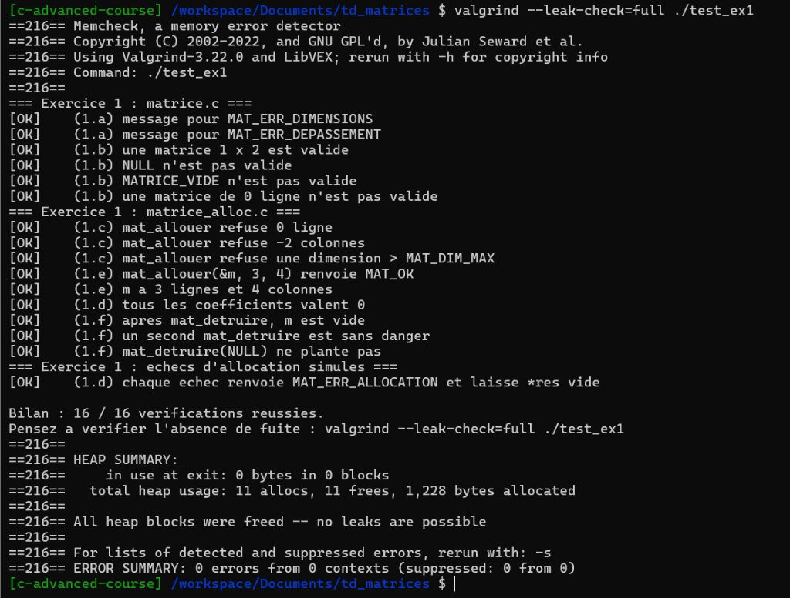
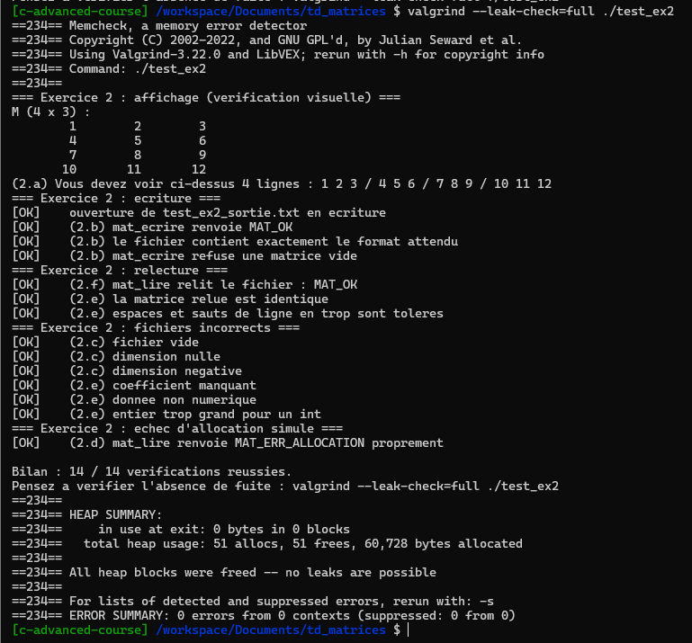
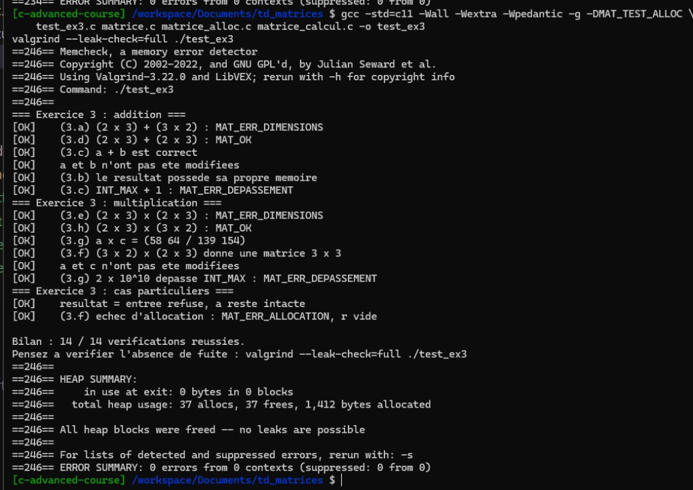

# Rapport TD — Stockage de matrices en C

**Élève :** <!-- À compléter -->
**Année :** 2026–2027

---

## Exercice 1 — Allocation et destruction

### Étapes réalisées

| Étape | Fichier | Description | Statut |
|---|---|---|---|
| 1.a | `matrice.c` | Messages d'erreur `MAT_ERR_DIMENSIONS` et `MAT_ERR_DEPASSEMENT` | ✅ |
| 1.b | `matrice.c` | `mat_est_valide` (4 conditions) | ✅ |
| 1.c | `matrice_alloc.c` | Refus des dimensions invalides | ✅ |
| 1.d | `matrice_alloc.c` | Allocation ligne par ligne + gestion échec partiel | ✅ |
| 1.e | `matrice_alloc.c` | Remplissage de `res->coef`, `res->nb_lignes`, `res->nb_colonnes` | ✅ |
| 1.f | `matrice_alloc.c` | `mat_detruire` | ✅ |

### Résultat des tests

```
Bilan : 16 / 16 vérifications réussies.
```

Compilation sans aucun avertissement avec :
```bash
gcc -std=c11 -Wall -Wextra -Wpedantic -g -DMAT_TEST_ALLOC \
    test_ex1.c matrice.c matrice_alloc.c -o test_ex1
```

---

### Questions de réflexion — Exercice 1

---

**Q3.1** Pourquoi `mat_detruire` prend-elle un `Matrice *` et non un `Matrice` ? Que se passerait-il, pour l'appelant, avec un passage par valeur ?

> `mat_detruire` reçoit un pointeur `Matrice *` car elle doit **modifier la variable de l'appelant** : après la destruction, elle remet `*m` à `MATRICE_VIDE` (champ `coef` remis à `NULL`, dimensions à 0). Avec un passage par valeur, la fonction travaillerait sur une **copie locale** de la structure : l'appelant ne verrait jamais la remise à `MATRICE_VIDE`, et `coef` resterait un pointeur pendouillant vers de la mémoire déjà libérée. Un deuxième appel involontaire à `free` provoquerait un comportement indéfini.

---

**Q3.2** Combien d'appels à `calloc` et à `free` faut-il pour une matrice *n×p* ? Si la *k*-ième allocation échoue, combien de libérations `mat_allouer` doit-elle effectuer ?

> Pour une matrice *n×p*, `mat_allouer` effectue **1 + n** appels à `calloc` :
> - 1 pour le tableau de `n` pointeurs de lignes (`int **coef`) ;
> - `n` pour les `n` tableaux de `p` entiers (une ligne chaque fois).
>
> En cas de succès, `mat_detruire` effectuera **n + 1** appels à `free` (les `n` lignes puis le tableau).
>
> Si la *k*-ième allocation échoue (en comptant à partir de 1) :
> - Si c'est le tableau de pointeurs (k = 1) : **0** libération de ligne, puis `free(coef)` → 1 `free` au total.
> - Si c'est la *k*-ième ligne (k ≥ 2, donc ligne numéro k-1) : on libère les **k-2** lignes déjà allouées, puis le tableau → **k-1** `free` au total.

---

**Q3.3** Appeler deux fois `free` sur la même adresse est un comportement indéfini. Pourquoi appeler deux fois `mat_detruire` sur la même matrice est-il sans danger ? Est-ce encore vrai si l'on a fait une copie `Matrice b = a;` puis appelé `mat_detruire(&a)` et `mat_detruire(&b)` ?

> `mat_detruire` est sans danger au deuxième appel car, à la fin du premier appel, elle remet `*m = MATRICE_VIDE` : `m->coef` vaut donc `NULL`. Au deuxième appel, la garde `if (m->coef != NULL)` est fausse, donc aucun `free` n't est exécuté.
>
> En revanche, si on fait `Matrice b = a;` puis `mat_detruire(&a)` et `mat_detruire(&b)`, c'est **dangereux** : `b.coef` est une copie de l'adresse `a.coef`. Après `mat_detruire(&a)`, `a.coef` est `NULL` mais `b.coef` pointe toujours vers la mémoire libérée. Le deuxième appel `mat_detruire(&b)` tentera de libérer deux fois la même mémoire → **comportement indéfini**. C'est pourquoi la règle R4 interdit de copier une `Matrice` par valeur lorsqu'on possède sa mémoire.

---

**Q3.4** Pourquoi `mat_allouer` commence-t-elle par l'affectation `*res = MATRICE_VIDE`, avant même de vérifier les dimensions ?

> Parce que `*res` est un **paramètre de sortie** dont le contenu initial est inconnu (règle R5) : l'appelant peut avoir passé une variable non initialisée. En mettant `*res` à `MATRICE_VIDE` dès le début, on garantit que, quel que soit le chemin d'erreur emprunté ensuite (dimensions invalides, allocation échouée…), `*res` est dans un état cohérent et sûr. Sans cette ligne, si la fonction renvoie une erreur avant d'avoir rien alloué, `*res` contiendrait des valeurs indéterminées et l'appelant ne pourrait pas appeler `mat_detruire` sans risque.

---

### Critères de validation — Exercice 1

- [x] `test_ex1` compile sans aucun avertissement.
- [x] `./test_ex1` affiche `Bilan : 16 / 16`.
- [x] `valgrind --leak-check=full ./test_ex1` affiche `All heap blocks were freed` — **11 allocs, 11 frees, 0 erreur**.

**Capture valgrind :**


- [x] Il ne reste aucune ligne provisoire dans `matrice.c` et `matrice_alloc.c`.

---

## Exercice 2 — Entrées-sorties

### Étapes réalisées

| Étape | Fichier | Description | Statut |
|---|---|---|---|
| 2.a | `matrice_io.c` | Afficher les coefficients avec `printf(" %8d", ...)` | ✅ |
| 2.b | `matrice_io.c` | Écriture au format canonique avec vérification des retours | ✅ |
| 2.c | `matrice_io.c` | Vérification des dimensions lues (`1` à `MAT_DIM_MAX`) | ✅ |
| 2.d | `matrice_io.c` | Réservation d'une matrice locale `tmp` | ✅ |
| 2.e | `matrice_io.c` | Lecture des coefficients via `lire_entier` et libération si échec | ✅ |
| 2.f | `matrice_io.c` | Transfert du résultat (`*res = tmp;`) et retour `MAT_OK` | ✅ |

### Résultat des tests

```
=== Exercice 2 : affichage (verification visuelle) ===
M (4 x 3) :
        1        2        3
        4        5        6
        7        8        9
       10       11       12
=== Exercice 2 : ecriture ===
[OK]    ouverture de test_ex2_sortie.txt en ecriture
[OK]    (2.b) mat_ecrire renvoie MAT_OK
[OK]    (2.b) le fichier contient exactement le format attendu
[OK]    (2.b) mat_ecrire refuse une matrice vide
=== Exercice 2 : relecture ===
[OK]    (2.f) mat_lire relit le fichier : MAT_OK
[OK]    (2.e) la matrice relue est identique
[OK]    (2.e) espaces et sauts de ligne en trop sont toleres
=== Exercice 2 : fichiers incorrects ===
[OK]    (2.c) fichier vide
[OK]    (2.c) dimension nulle
[OK]    (2.c) dimension negative
[OK]    (2.e) coefficient manquant
[OK]    (2.e) donnee non numerique
[OK]    (2.e) entier trop grand pour un int
=== Exercice 2 : echec d'allocation simule ===
[OK]    (2.d) mat_lire renvoie MAT_ERR_ALLOCATION proprement

Bilan : 14 / 14 vérifications réussies.
```

---

### Questions de réflexion — Exercice 2

**Q4.1** Pourquoi `mat_lire` remplit-elle d'abord une matrice locale avant de l'affecter à `*res` ?

> Pour respecter strictement la règle R3 de gestion de la mémoire : si la lecture échoue en cours de route (fichier mal formé, dimensions erronées, fichier tronqué, données non numériques), `mat_detruire(&tmp)` libère toute la mémoire déjà allouée et `*res` reste intact à l'état `MATRICE_VIDE`. L'affectation `*res = tmp;` n'a lieu que lorsque l'ensemble des coefficients a été lu avec succès.

---

**Q4.2** La lecture vérifie-t-elle que chaque ligne de la matrice est sur sa propre ligne de texte ? Est-ce gênant ? Justifiez le principe « tolérant en lecture, strict en écriture ».

> Non, la lecture ne le vérifie pas car `lire_entier` utilise `fscanf` avec `%s` puis `strtol`, ce qui traite de manière équivalente tous les caractères d'espacement (espaces, tabulations, retours à la ligne `\n`). 
> Ce n'est pas gênant car le nombre exact de coefficients attendus est strictement contrôlé ($n \times p$).
> Le principe « tolérant en lecture, strict en écriture » (loi de Postel / Robustness Principle) permet d'accepter des fichiers générés par d'autres logiciels, éditeurs ou systèmes d'exploitation (variations de retours chariot, espaces superflus), tout en garantissant que nos propres sorties sont rigoureusement canoniques, propres et universellement lisibles.

---

**Q4.3** Après l'appel `mat_lire(f, &m)`, le flux `f` est positionné après le dernier coefficient. Comment exploiter cette propriété pour stocker deux matrices dans un même fichier ?

> Comme `mat_lire` ne ferme pas le flux (règle R7) et s'arrête exactement après avoir lu les $n \times p$ coefficients, le curseur du fichier reste positionné juste au début des données suivantes. On peut donc enchaîner directement `mat_lire(f, &m1)` puis `mat_lire(f, &m2)` sur le même flux sans devoir calculer d'offset ni appeler `fseek`. De même en écriture, on appelle successivement `mat_ecrire(f, &m1)` puis `mat_ecrire(f, &m2)`.

---

**Q4.4** Pourquoi `mat_ecrire` appelle-t-elle `fflush` avant de renvoyer `MAT_OK` ? Cela dispense-t-il l'appelant de tester `fclose` ?

> `fflush(f)` force l'écriture immédiate des données présentes dans le tampon de la bibliothèque standard vers le système d'exploitation. Cela permet à `mat_ecrire` d'intercepter une erreur d'écriture (par exemple disque saturé ou canal interrompu) et de renvoyer `MAT_ERR_ECRITURE`.
> Cependant, cela ne dispense pas l'appelant de tester la valeur de retour de `fclose(f)`, car `fclose` finalise la clôture du fichier au niveau du système d'exploitation (libération du descripteur de fichier) et peut lui-même échouer.

---

### Critères de validation — Exercice 2

- [x] `test_ex2` compile sans aucun avertissement.
- [x] `./test_ex2` affiche `Bilan : 14 / 14`.
- [x] `valgrind --leak-check=full ./test_ex2` affiche `All heap blocks were freed` — **51 allocs, 51 frees, 0 erreur**.

**Capture valgrind :**


- [x] Aucune fonction de `matrice_io.c` n'appelle `fopen` ni `fclose`, et il ne reste aucune ligne provisoire.

---

## Exercice 3 — Calcul matriciel

### Étapes réalisées

| Étape | Fichier | Description | Statut |
|---|---|---|---|
| 3.a | `matrice_calcul.c` | Addition : contrôle des dimensions identiques ($n \times p$) | ✅ |
| 3.b | `matrice_calcul.c` | Addition : réservation de la matrice résultat | ✅ |
| 3.c | `matrice_calcul.c` | Addition : calcul en `long long` avec détection de débordement | ✅ |
| 3.d | `matrice_calcul.c` | Addition : transfert du résultat (`*res = r; return MAT_OK;`) | ✅ |
| 3.e | `matrice_calcul.c` | Multiplication : contrôle des dimensions ($cols(a) == rows(b)$) | ✅ |
| 3.f | `matrice_calcul.c` | Multiplication : réservation du résultat ($rows(a) \times cols(b)$) | ✅ |
| 3.g | `matrice_calcul.c` | Multiplication : somme des produits avec contrôle de débordement | ✅ |
| 3.h | `matrice_calcul.c` | Multiplication : transfert du résultat (`*res = r; return MAT_OK;`) | ✅ |

### Résultat des tests

```
=== Exercice 3 : addition ===
[OK]    (3.a) (2 x 3) + (3 x 2) : MAT_ERR_DIMENSIONS
[OK]    (3.d) (2 x 3) + (2 x 3) : MAT_OK
[OK]    (3.c) a + b est correct
[OK]    a et b n'ont pas ete modifiees
[OK]    (3.b) le resultat possede sa propre memoire
[OK]    (3.c) INT_MAX + 1 : MAT_ERR_DEPASSEMENT
=== Exercice 3 : multiplication ===
[OK]    (3.e) (2 x 3) x (2 x 3) : MAT_ERR_DIMENSIONS
[OK]    (3.h) (2 x 3) x (3 x 2) : MAT_OK
[OK]    (3.g) a x c = (58 64 / 139 154)
[OK]    (3.f) (3 x 2) x (2 x 3) donne une matrice 3 x 3
[OK]    a et c n'ont pas ete modifiees
[OK]    (3.g) 2 x 10^10 depasse INT_MAX : MAT_ERR_DEPASSEMENT
=== Exercice 3 : cas particuliers ===
[OK]    resultat = entree refuse, a reste intacte
[OK]    (3.f) echec d'allocation : MAT_ERR_ALLOCATION, r vide

Bilan : 14 / 14 vérifications réussies.
```

---

### Questions de réflexion — Exercice 3

**Q5.1** Le paramètre `const Matrice *a` empêche-t-il d'écrire `a->coef[0][0] = 7;` ? Que protège exactement ce `const` ? Que faudrait-il changer pour que le compilateur refuse cette affectation ?

> Non, `const Matrice *a` n'empêche pas d'écrire `a->coef[0][0] = 7;`. Ce `const` protège uniquement les membres directs de la structure `Matrice` pointée par `a` (interdisant par exemple d'écrire `a->nb_lignes = 5` ou `a->coef = NULL`). En revanche, il ne protège pas les données situées derrière les pointeurs sur le tas car le type de `coef` est `int **` (pointeur vers pointeur vers int non-const).
> Pour que le compilateur refuse toute modification des coefficients, il faudrait déclarer les coefficients en `const int * const *coef;`.

---

**Q5.2** Pourquoi refuse-t-on l'appel `mat_additionner(&a, &b, &a)` alors que, mathématiquement, *a ← a+b* a un sens ? Que se passerait-il avec notre implémentation si on l'acceptait ?

> On refuse cet appel pour éviter l'aliasing et respecter les règles de gestion mémoire (R3 et R5). Dans notre architecture, la fonction commence par initialiser la sortie avec `*res = MATRICE_VIDE;`. Si `res` et `a` pointaient vers la même structure, écraser `*res` détruirait immédiatement les références vers les coefficients de `a` avant même le début du calcul. Cela provoquerait une fuite de la mémoire originale de `a`, suivie d'un déréférencement de pointeur nul (`NULL`) provoquant un plantage (`Segmentation Fault`).
> Pour faire mathématiquement $a \leftarrow a + b$, l'utilisateur doit allouer une matrice temporaire `res`, détruire l'ancienne `a` avec `mat_detruire(&a)`, puis affecter `a = res`.

---

**Q5.3** Combien de multiplications d'entiers effectue `mat_multiplier` pour des matrices *n×p* et *p×q* ? Combien pour deux matrices *1000×1000* ?

> Pour une matrice $A$ de dimensions $n \times p$ et $B$ de dimensions $p \times q$, la matrice résultat comporte $n \times q$ coefficients. Le calcul de chaque coefficient requiert $p$ multiplications élémentaires. Le nombre total de multiplications est donc :
> $$N = n \times p \times q$$
> Pour deux matrices carrées $1000 \times 1000$ ($n = p = q = 1000$) :
> $$N = 1000 \times 1000 \times 1000 = 10^9 \text{ (1 milliard d'opérations)}.$$

---

**Q5.4** Pourquoi ne suffit-il pas de calculer `int s = a + b;` puis de tester `s < a` pour détecter un dépassement ?

> 1. En norme C, le débordement arithmétique sur les entiers signés (`int`) est un **comportement indéfini** (*Undefined Behavior*). Le compilateur a légalement le droit de supposer qu'un tel débordement n'arrive jamais et d'éliminer le test `s < a` lors des optimisations (`-O2` / `-O3`).
> 2. Si l'opérande $b$ est négatif, la relation $a + b < a$ est toujours vraie, produisant ainsi un faux positif.
> La méthode robuste consiste donc à effectuer le calcul dans un type de plus grande capacité (`long long`) ou à vérifier les bornes *avant* l'opération.

---

### Critères de validation — Exercice 3

- [x] `test_ex3` compile sans aucun avertissement avec `-std=c11 -Wall -Wextra -Wpedantic`.
- [x] `./test_ex3` affiche `Bilan : 14 / 14`.
- [x] `valgrind --leak-check=full ./test_ex3` affiche `All heap blocks were freed` — **37 allocs, 37 frees, 0 erreur**.

**Capture valgrind :**


- [x] Il ne reste aucune ligne provisoire dans `matrice_calcul.c`.

---

## Exercice 4 — Démonstration complète

### Étapes réalisées

| Étape | Fichier | Description | Statut |
|---|---|---|---|
| 4.a | `main.c` | Affichage des matrices $A$ et $B$ avec `mat_afficher` | ✅ |
| 4.b | `main.c` | Calcul du résultat $R$ avec `mat_additionner` ou `mat_multiplier` et gestion d'erreur | ✅ |
| 4.c | `main.c` | Affichage de la matrice résultat $R$ (`"R = A + B"` ou `"R = A x B"`) | ✅ |
| 4.d | `main.c` | Message de succès d'enregistrement et `statut = EXIT_SUCCESS` | ✅ |

### Validation des 10 scénarios de test

Résultats complets des tests locaux et **valgrind sous Linux** :

| # | Scénario | Résultat | Code sortie | Valgrind |
|---|---|---|---|---|
| 1 | `add A.txt B.txt R.txt` | A, B, R (4x3) affichés, `R.txt` créé | 0 ✅ | 22 allocs, 22 frees — 0 fuite ✅ |
| 1bis | `add R.txt R.txt R2.txt` | R.txt relu immédiatement — succès | 0 ✅ | 22 allocs, 22 frees — 0 fuite ✅ |
| 2 | `mul A.txt C.txt R.txt` | R (4x2) affiché, `R.txt` créé | 0 ✅ | 21 allocs, 21 frees — 0 fuite ✅ |
| 3 | `add A.txt C.txt R.txt` | `dimensions incompatibles (4x3 et 3x2)` | 1 ✅ | 14 allocs, 14 frees — 0 fuite ✅ |
| 4 | `mul A.txt B.txt R.txt` | `dimensions incompatibles (4x3 et 4x3)` | 1 ✅ | 15 allocs, 15 frees — 0 fuite ✅ |
| 5 | fichier absent | `impossible d'ouvrir "..." : No such file or directory` | 1 ✅ | 1 alloc, 1 free — 0 fuite ✅ |
| 6 | `invalide.txt` | `lecture de "..." : fichier mal formé` | 1 ✅ | 5 allocs, 5 frees — 0 fuite ✅ |
| 7 | `tronque.txt` | `lecture de "..." : fichier mal formé` | 1 ✅ | 6 allocs, 6 frees — 0 fuite ✅ |
| 8 | dossier inexistant | `impossible de créer "..." : No such file or directory` | 1 ✅ | 21 allocs, 21 frees — 0 fuite ✅ |
| 9 | `-DMAT_TEST_ALLOC` (simulation) | `MAT_ERR_ALLOCATION` — `mémoire insuffisante (4x3 et 4x3)`, r vide | 1 ✅ | 15 allocs, 15 frees — 0 fuite ✅ |
| 10 | args manquants | message d'usage sur `stderr` | 1 ✅ | 0 allocs, 0 frees — 0 fuite ✅ |

---

### Questions de réflexion — Exercice 4

**Q6.1** Pourquoi le message d'erreur est-il affiché par `main.c` (ou ses fonctions `static`) et non par `mat_lire` ? Pensez à un programme graphique qui réutiliserait la bibliothèque.

> Pour respecter le principe de **séparation des responsabilités** (séparation bibliothèque / interface utilisateur).
> Les modules de la bibliothèque (`matrice_io`, `matrice_calcul`, `matrice_alloc`) sont conçus pour être réutilisables dans n'importe quel type d'application : une interface graphique (GUI avec pop-up d'erreur), un service web (API JSON), un composant embarqué sans sortie standard, ou un outil CLI. Si `mat_lire` écrivait directement des messages avec `printf` ou `fprintf(stderr, ...)`, elle polluerait les flux et imposerait sa propre mise en forme textuelle.
> En se limitant à retourner des codes d'erreur (`MatErreur`), la bibliothèque laisse à chaque programme appelant (`main.c`) la liberté totale de décider comment traiter, journaliser ou afficher l'erreur à l'utilisateur.

---

**Q6.2** Pourquoi le résultat de `fclose` est-il testé dans `sauvegarder` mais pas dans `charger` ?

> - **En écriture (`sauvegarder`)** : l'écriture sur disque est mise en mémoire tampon (*buffering*). C'est souvent lors de l'appel à `fclose` que le vidage final du tampon (*flush*) vers le périphérique physique a lieu. Si le disque est plein, le quota dépassé ou le support retiré, l'erreur d'E/S matérielle n'apparaît qu'à ce moment-là. Ignorer le résultat de `fclose` en écriture risquerait de considérer une sauvegarde comme réussie alors que le fichier est corrompu ou incomplet sur le disque.
> - **En lecture (`charger`)** : toutes les données ont déjà été lues avec succès depuis le fichier et stockées en mémoire. `fclose` se borne à libérer le descripteur de fichier auprès du système d'exploitation. Même si cette libération système rencontrait une anomalie, les données sont déjà parfaitement disponibles en RAM et le travail de chargement est accompli.

---

**Q6.3** Dans le scénario 8, le calcul a réussi mais l'enregistrement a échoué. Combien de matrices faut-il libérer ? Vérifiez que votre programme le fait.

> Il faut libérer **3 matrices** : `a`, `b` et `r`.
> - `a` et `b` possèdent de la mémoire allouée lors de leur chargement avec `charger`.
> - `r` possède de la mémoire allouée lors de l'exécution de l'opération arithmétique (`mat_additionner` ou `mat_multiplier`).
> Notre programme garantit cette libération grâce au point de sortie unique :
> ```c
> nettoyage:
>     mat_detruire(&r);
>     mat_detruire(&b);
>     mat_detruire(&a);
>     return statut;
> ```
> Toutes les matrices allouées sont ainsi détruites exactement une fois avant de quitter le programme, empêchant toute fuite de mémoire.

---

### Critères de validation — Exercice 4

- [x] Le programme compile sans aucun avertissement avec `-std=c11 -Wall -Wextra -Wpedantic`.
- [x] `main.c` n'inclut que des en-têtes ; aucun module ne contient de fonction `main`.
- [x] Les dix scénarios donnent le comportement attendu.
- [x] Le fichier produit par le scénario 1 peut être relu : `./demo_matrices add R.txt R.txt R2.txt`.
- [ ] `valgrind` ne signale ni fuite ni accès invalide dans aucun scénario.
- [x] Les trois programmes `test_ex1`, `test_ex2`, `test_ex3` affichent toujours un bilan complet.

